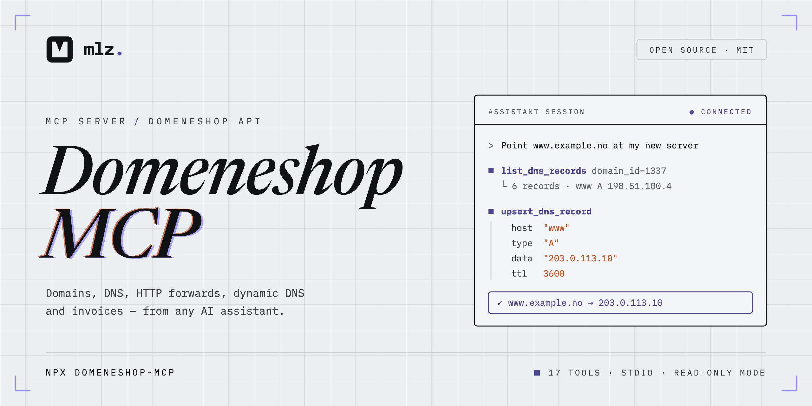

<p align="center">
  <picture>
    <source media="(prefers-color-scheme: dark)" srcset=".github/assets/banner-dark.png">
    
  </picture>
</p>

<p align="center">
  <a href="https://github.com/martinzachariassen/domeneshop-mcp/actions/workflows/ci.yml"></a>
  <a href="https://www.npmjs.com/package/domeneshop-mcp"></a>
  <a href="https://www.npmjs.com/package/domeneshop-mcp"></a>
  <a href="LICENSE"></a>
</p>

**Manage your [Domeneshop](https://www.domeneshop.no) domains by asking your AI
assistant.** DNS records, HTTP forwards, dynamic DNS and invoices, all in plain
language. Works with Claude, Cursor, VS Code, Codex and any other
[MCP](https://modelcontextprotocol.io) client.

> "Point blog.example.no at 203.0.113.10"<br>
> "Set up Fastmail's MX records on example.no"<br>
> "Which of my domains renew this year?"

The assistant picks the right tool, shows you what it is about to change and
asks before it does.

## Getting started

**1. Get an API token and secret** from
[domeneshop.no/admin?view=api](https://www.domeneshop.no/admin?view=api).

**2. Add the server.** With [Claude Code](https://claude.com/claude-code):

```sh
claude mcp add domeneshop \
  --env DOMENESHOP_API_TOKEN=<your-api-token> \
  --env DOMENESHOP_API_SECRET=<your-api-secret> \
  -- npx -y domeneshop-mcp
```

Using Claude Desktop, Cursor, VS Code or something else?
**[Pick your client below](#client-setup).** Most have a one-click install.

**3. Try it.** Start a new session and ask *"List my Domeneshop domains"*.

> [!TIP]
> Not ready to let an assistant touch live DNS? Add
> `--env DOMENESHOP_READ_ONLY=true` and it can look at everything but change
> nothing.

Requires Node.js 22 or newer ([download](https://nodejs.org)), except for the
Claude Desktop bundle.

<details>
<summary><strong>New to MCP?</strong></summary>

MCP (Model Context Protocol) is an open standard that lets AI apps call outside
tools. This package is an *MCP server*: a small program your AI app starts in
the background. You never run it yourself and you do not need to know the tool
names. You just ask.

The API token and secret let a program act on your Domeneshop account, so
treat them like a password.

</details>

## What you can ask for

| Area | Example prompt |
| --- | --- |
| Domains | "Which domains are on my account, and when do they renew?" |
| DNS | "Show every DNS record for example.no" |
| DNS | "Lower the TTL on the www record for example.no to 5 minutes" |
| DNS | "Add the TXT record Google gave me for domain verification" |
| Forwarding | "Forward old.example.no to https://example.no" |
| Dynamic DNS | "Update home.example.no to my current IP" |
| Invoices | "List my unpaid Domeneshop invoices" |

## Client setup

Every client needs the same two environment variables, `DOMENESHOP_API_TOKEN`
and `DOMENESHOP_API_SECRET`. Most take this **standard config**. If the file
already lists other servers, add the `"domeneshop"` entry inside the existing
`"mcpServers"` object:

```json
{
  "mcpServers": {
    "domeneshop": {
      "command": "npx",
      "args": ["-y", "domeneshop-mcp"],
      "env": {
        "DOMENESHOP_API_TOKEN": "<your-api-token>",
        "DOMENESHOP_API_SECRET": "<your-api-secret>"
      }
    }
  }
}
```

<details>
<summary><strong>Claude Code</strong></summary>

Use the command from [Getting started](#getting-started). It registers the
server for you in this project only (`--scope local`). Add `--scope user` to
make it available in every project, or `--scope project` to write
`<your-project>/.mcp.json` and share it through version control.

You can also pass the standard config as raw JSON:

```sh
claude mcp add-json domeneshop '{"command":"npx","args":["-y","domeneshop-mcp"],"env":{"DOMENESHOP_API_TOKEN":"<your-api-token>","DOMENESHOP_API_SECRET":"<your-api-secret>"}}'
```

Run `/mcp` in a session, or `claude mcp list`, to check that it connects.

</details>

<details>
<summary><strong>Claude Desktop</strong>: one-click bundle, no Node.js needed</summary>

1. Download `domeneshop-mcp-<version>.mcpb` from the
   [latest release](https://github.com/martinzachariassen/domeneshop-mcp/releases/latest).
2. Open it (double-click, or drag it into Claude Desktop).
3. Paste your token and secret, optionally turn on read-only mode, and install.

Claude Desktop stores the credentials securely.

To configure it by hand instead, add the standard config to
`claude_desktop_config.json` (Settings → Developer → Edit Config), then restart
Claude Desktop:

| Platform | Full path |
| --- | --- |
| macOS | `~/Library/Application Support/Claude/claude_desktop_config.json` |
| Windows | `%APPDATA%\Claude\claude_desktop_config.json` |
| Linux (unofficial builds) | `~/.config/Claude/claude_desktop_config.json` |

</details>

<details>
<summary><strong>Cursor</strong>: one-click install</summary>

[](https://cursor.com/en/install-mcp?name=domeneshop&config=eyJjb21tYW5kIjoibnB4IiwiYXJncyI6WyIteSIsImRvbWVuZXNob3AtbWNwIl0sImVudiI6eyJET01FTkVTSE9QX0FQSV9UT0tFTiI6Ijx5b3VyLWFwaS10b2tlbj4iLCJET01FTkVTSE9QX0FQSV9TRUNSRVQiOiI8eW91ci1hcGktc2VjcmV0PiJ9fQ%3D%3D)

The button installs the server with placeholder credentials. Afterwards, open
**Settings → MCP**, edit the `domeneshop` entry and replace `<your-api-token>`
and `<your-api-secret>` with your own.

To set it up by hand instead, add the standard config to an `mcp.json` file:

| Scope | Full path |
| --- | --- |
| This project only | `<your-project>/.cursor/mcp.json` |
| Every project (macOS/Linux) | `~/.cursor/mcp.json` |
| Every project (Windows) | `%USERPROFILE%\.cursor\mcp.json` |

</details>

<details>
<summary><strong>VS Code (GitHub Copilot)</strong>: one-click install</summary>

[](https://insiders.vscode.dev/redirect/mcp/install?name=domeneshop&inputs=%5B%7B%22type%22%3A%22promptString%22%2C%22id%22%3A%22domeneshop_api_token%22%2C%22description%22%3A%22Domeneshop%20API%20token%22%2C%22password%22%3Atrue%7D%2C%7B%22type%22%3A%22promptString%22%2C%22id%22%3A%22domeneshop_api_secret%22%2C%22description%22%3A%22Domeneshop%20API%20secret%22%2C%22password%22%3Atrue%7D%5D&config=%7B%22command%22%3A%22npx%22%2C%22args%22%3A%5B%22-y%22%2C%22domeneshop-mcp%22%5D%2C%22env%22%3A%7B%22DOMENESHOP_API_TOKEN%22%3A%22%24%7Binput%3Adomeneshop_api_token%7D%22%2C%22DOMENESHOP_API_SECRET%22%3A%22%24%7Binput%3Adomeneshop_api_secret%7D%22%7D%7D)
[](https://insiders.vscode.dev/redirect/mcp/install?name=domeneshop&inputs=%5B%7B%22type%22%3A%22promptString%22%2C%22id%22%3A%22domeneshop_api_token%22%2C%22description%22%3A%22Domeneshop%20API%20token%22%2C%22password%22%3Atrue%7D%2C%7B%22type%22%3A%22promptString%22%2C%22id%22%3A%22domeneshop_api_secret%22%2C%22description%22%3A%22Domeneshop%20API%20secret%22%2C%22password%22%3Atrue%7D%5D&config=%7B%22command%22%3A%22npx%22%2C%22args%22%3A%5B%22-y%22%2C%22domeneshop-mcp%22%5D%2C%22env%22%3A%7B%22DOMENESHOP_API_TOKEN%22%3A%22%24%7Binput%3Adomeneshop_api_token%7D%22%2C%22DOMENESHOP_API_SECRET%22%3A%22%24%7Binput%3Adomeneshop_api_secret%7D%22%7D%7D&quality=insiders)

The buttons install the server in your user configuration. VS Code then asks
for your token and secret and stores them securely, so nothing is written to a
config file in plain text.

To set it up by hand instead, note that VS Code uses a `servers` key instead of
`mcpServers` and wants an explicit `type`. For this project only, add it to
`<your-project>/.vscode/mcp.json`:

```json
{
  "servers": {
    "domeneshop": {
      "type": "stdio",
      "command": "npx",
      "args": ["-y", "domeneshop-mcp"],
      "env": {
        "DOMENESHOP_API_TOKEN": "<your-api-token>",
        "DOMENESHOP_API_SECRET": "<your-api-secret>"
      }
    }
  }
}
```

For every project, run **MCP: Open User Configuration** from the command
palette and add the same block, or register it in one line:

```sh
code --add-mcp '{"name":"domeneshop","command":"npx","args":["-y","domeneshop-mcp"],"env":{"DOMENESHOP_API_TOKEN":"<your-api-token>","DOMENESHOP_API_SECRET":"<your-api-secret>"}}'
```

</details>

<details>
<summary><strong>Codex</strong></summary>

Add this to `~/.codex/config.toml` (`%USERPROFILE%\.codex\config.toml` on
Windows):

```toml
[mcp_servers.domeneshop]
command = "npx"
args = ["-y", "domeneshop-mcp"]
env = { DOMENESHOP_API_TOKEN = "<your-api-token>", DOMENESHOP_API_SECRET = "<your-api-secret>" }
```

`codex mcp add domeneshop -- npx -y domeneshop-mcp` also works, but takes no
env flags, so set the two variables in the block it creates.

</details>

<details>
<summary><strong>Windsurf, Cline, Continue, LM Studio and others</strong></summary>

Anything that runs MCP servers over stdio works. Most use the standard config
above. Check your client's documentation for the config file and key name, then
point it at:

- **command**: `npx`
- **args**: `["-y", "domeneshop-mcp"]`
- **env**: `DOMENESHOP_API_TOKEN` and `DOMENESHOP_API_SECRET`

</details>

<details>
<summary><strong>Install with Homebrew or npm instead of npx</strong></summary>

To avoid resolving the package on every launch, install it once and use
`domeneshop-mcp` as the command with no args:

```sh
brew install martinzachariassen/tap/domeneshop-mcp   # macOS/Linux, installs Node.js if missing
npm install -g domeneshop-mcp                        # or with npm
```

In Claude Code, that means `-- domeneshop-mcp` in place of
`-- npx -y domeneshop-mcp`. `brew upgrade domeneshop-mcp` picks up new releases.

GUI apps such as Claude Desktop usually do not see Homebrew's `PATH`, so give
them the full path. `brew --prefix` prints it: `/opt/homebrew` on Apple
silicon, `/usr/local` on Intel Macs, `/home/linuxbrew/.linuxbrew` on Linux.

```json
{
  "mcpServers": {
    "domeneshop": {
      "command": "/opt/homebrew/bin/domeneshop-mcp",
      "env": {
        "DOMENESHOP_API_TOKEN": "<your-api-token>",
        "DOMENESHOP_API_SECRET": "<your-api-secret>"
      }
    }
  }
}
```

</details>

## Configuration

All settings are environment variables, passed with `--env` in Claude Code or
in the `env` block of your client config. Only the first two are required.

| Variable | Required | Description |
| --- | --- | --- |
| `DOMENESHOP_API_TOKEN` | Yes | API token from the Domeneshop control panel |
| `DOMENESHOP_API_SECRET` | Yes | The matching API secret |
| `DOMENESHOP_READ_ONLY` | No | `true` to expose only read-only tools |
| `DOMENESHOP_TOOLS` | No | Comma-separated allowlist of tool names to expose |
| `DOMENESHOP_DISABLED_TOOLS` | No | Comma-separated tool names to hide |
| `DOMENESHOP_TIMEOUT_MS` | No | Per-request timeout in milliseconds (default `30000`) |
| `DOMENESHOP_DEBUG` | No | `true` to log every API request to stderr |

## Tools

17 tools cover every operation the Domeneshop API offers. You don't need to know
their names, because the assistant picks them for you. Arguments are validated
before anything is sent (TTL range, URL scheme, IP addresses, the fields each
record type requires), so a mistake comes back as an explanation, not a bare API
error.

> [!WARNING]
> `update_dns_record` replaces the **whole** record: omitted fields are dropped
> and an omitted `ttl` resets to 3600 seconds. Use `patch_dns_record` to change
> only some fields. `upsert_dns_record` refuses to act when a host has several
> records of the same type (typical for `MX` and `TXT`) and lists their IDs
> instead.

<details>
<summary><strong>All tools</strong></summary>

**Access** mirrors the MCP annotations each tool declares, which clients use to
decide what to run without asking.

| Area | Tool | Access | Description |
| --- | --- | --- | --- |
| Domains | `list_domains` | Read-only | List all domains on the account, optionally filtered by name |
| | `get_domain` | Read-only | Get a single domain by its Domeneshop domain ID |
| DNS | `list_dns_records` | Read-only | List a domain's records, optionally filtered by host and type |
| | `get_dns_record` | Read-only | Get a single record by ID |
| | `create_dns_record` | Adds | Create a record and return it as stored |
| | `update_dns_record` | Overwrites | Replace a whole record (see the warning above) |
| | `patch_dns_record` | Overwrites | Change only the given fields of a record |
| | `upsert_dns_record` | Overwrites | Update the single record for a host and type, or create it if there is none |
| | `delete_dns_record` | Deletes | Delete a record |
| Forwarding | `list_forwards` | Read-only | List a domain's HTTP forwards |
| | `get_forward` | Read-only | Get the forward for one host |
| | `create_forward` | Adds | Create a forward to an `http://`, `https://` or `ftp://` URL |
| | `update_forward` | Overwrites | Update a forward's destination or frame setting; an omitted `frame` keeps its stored value |
| | `delete_forward` | Deletes | Delete a forward |
| Dynamic DNS | `update_dyndns` | Overwrites | Point one or more comma-separated hostnames at up to nine IPv4/IPv6 addresses, or at the caller's apparent IP; creates the record if missing |
| Invoices | `list_invoices` | Read-only | List invoices from the past three years, optionally filtered by status |
| | `get_invoice` | Read-only | Get a single invoice |

</details>

<details>
<summary><strong>Supported DNS record types</strong></summary>

All eleven record types Domeneshop accepts are supported:

| Type | Fields beyond `host`, `data` and `ttl` |
| --- | --- |
| `A`, `AAAA`, `ANAME`, `CNAME`, `NS`, `TXT` | — |
| `MX` | `priority` |
| `SRV` | `priority`, `weight`, `port` |
| `TLSA` | `usage`, `selector`, `dtype` |
| `DS` | `tag`, `alg`, `digest` |
| `CAA` | `flags`, `tag` |

`tag` is a number for `DS` (the key tag, 0-65535) and a string for `CAA` (the
property tag, such as `issue`). `A` and `AAAA` data must be an address of the
matching family, and the numeric fields are range-checked.

</details>

## Safety

> [!IMPORTANT]
> Domeneshop has no scoped tokens: a token can do everything your account can.
> Limit what the assistant can do by limiting which tools the server exposes.

- **Read-only mode**: `DOMENESHOP_READ_ONLY=true` exposes only the eight
  read-only tools. This is a good default for trying the server out.
- **Allowlist**: `DOMENESHOP_TOOLS=list_domains,list_dns_records,patch_dns_record`
  exposes exactly those tools.
- **Denylist**: `DOMENESHOP_DISABLED_TOOLS=delete_dns_record,delete_forward`
  hides specific tools.

Hidden tools are not registered at all, so the model never sees them. The
settings combine, and a misspelled tool name stops the server at startup
instead of being silently ignored.

Keep your client's confirmation prompt on for write tools. They change live
DNS, and a wrong record can take a site or mailbox offline.

Credentials are only sent to `api.domeneshop.no` and are never logged. To revoke
access, delete the token in the Domeneshop control panel.

## Troubleshooting

| Problem | Fix |
| --- | --- |
| The tools don't show up | Restart the client (most load servers only at startup), or check `/mcp` in Claude Code. Run `npx -y domeneshop-mcp --version` to confirm Node.js 22+ and npx work. If you edited a JSON config by hand, check that it is still valid. |
| `API returned status 401` | The token or secret is wrong. Copy both again from [domeneshop.no/admin?view=api](https://www.domeneshop.no/admin?view=api). Surrounding whitespace is trimmed automatically. |
| `API returned status 404` | The domain or record ID doesn't exist on this account. Ask the assistant to list domains or records first. |
| Timeouts | Requests give up after 30 seconds. Idempotent requests are retried on rate limiting and temporary errors. Raise the limit with `DOMENESHOP_TIMEOUT_MS`. |
| A DNS change doesn't show up | DNS is cached for the record's TTL (3600 seconds by default), so resolvers may serve the old value for up to an hour. Ask the assistant to show the record to confirm Domeneshop stored it. |

For more detail, set `DOMENESHOP_DEBUG=true`. The server then logs every API
request (method, path, status and duration, never credentials) to stderr, which
most clients show in their MCP logs.

Still stuck? [Open an issue](https://github.com/martinzachariassen/domeneshop-mcp/issues/new/choose).

## Contributing

Issues and pull requests are welcome. See [CONTRIBUTING.md](CONTRIBUTING.md) for
the development workflow, and the
[API notes](https://github.com/martinzachariassen/domeneshop-mcp/blob/main/docs/api-notes.md)
for undocumented Domeneshop behaviour the client relies on. Everyone taking part
is expected to follow the [Code of Conduct](CODE_OF_CONDUCT.md).

Available on [npm](https://www.npmjs.com/package/domeneshop-mcp),
[Homebrew](https://github.com/martinzachariassen/homebrew-tap), the
[MCP Registry](https://registry.modelcontextprotocol.io/v0/servers?search=io.github.martinzachariassen/domeneshop-mcp)
and as a [Claude Desktop bundle](https://github.com/martinzachariassen/domeneshop-mcp/releases/latest).
To report a vulnerability, see [SECURITY.md](SECURITY.md).
Licensed under [MIT](LICENSE).
