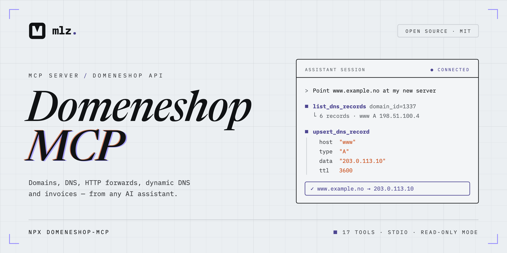

<p align="center">
  <picture>
    <source media="(prefers-color-scheme: dark)" srcset=".github/assets/banner-dark.png">
    
  </picture>
</p>

<p align="center">
  <a href="https://github.com/martinzachariassen/domeneshop-mcp/actions/workflows/ci.yml"></a>
  <a href="https://www.npmjs.com/package/domeneshop-mcp"></a>
  <a href="https://www.npmjs.com/package/domeneshop-mcp"></a>
  <a href="package.json"></a>
  <a href="https://github.com/martinzachariassen/domeneshop-mcp/actions/workflows/codeql.yml"></a>
  <a href="https://scorecard.dev/viewer/?uri=github.com/martinzachariassen/domeneshop-mcp"></a>
  <a href="LICENSE"></a>
</p>

<p align="center">
  <a href="#quick-start"><b>Quick start</b></a>
  &nbsp;·&nbsp;
  <a href="#client-setup"><b>Client setup</b></a>
  &nbsp;·&nbsp;
  <a href="#tools"><b>Tools</b></a>
  &nbsp;·&nbsp;
  <a href="#access-control"><b>Access control</b></a>
  &nbsp;·&nbsp;
  <a href="#troubleshooting"><b>Troubleshooting</b></a>
  &nbsp;·&nbsp;
  <a href="https://www.domeneshop.no/admin?view=api"><b>Get API credentials</b></a>
</p>

An [MCP](https://modelcontextprotocol.io) server that turns the
[Domeneshop API](https://api.domeneshop.no/docs/) into tools an assistant can call.
Every operation the API offers is covered — 17 tools across domains, DNS, HTTP
forwarding, dynamic DNS and invoices.

It talks MCP over stdio, so it works with **any MCP-compatible client**: Claude
Code, Claude Desktop, Cursor, VS Code, Codex, Windsurf, Cline and others.

<details>
<summary><strong>New to MCP? Start here</strong></summary>

[MCP](https://modelcontextprotocol.io) (Model Context Protocol) is an open
standard that lets AI apps call outside tools. This package is an *MCP server*:
a small program your AI app starts in the background and talks to. Once it is
registered, you just ask in plain language — "point blog.example.no at
203.0.113.10" — and the assistant picks the right tool, shows you what it is
about to do and asks before changing anything.

You never run the server yourself, and you do not need to know the tool names.
What you need:

- A **Domeneshop API token and secret**, a key pair that lets a program act on
  your account. Treat them like a password.
- An **MCP client**, the app you chat with. Claude Code is used below; any
  other works too (see [Client setup](#client-setup)).
- **Node.js 20.3+** ([download the LTS](https://nodejs.org)) or Homebrew. Not
  needed for the Claude Desktop bundle.

If you are unsure about letting an assistant change live DNS, start in
[read-only mode](#access-control): it can look at everything but change nothing.

</details>

## Quick start

You need a Domeneshop account, plus either Node.js 20.3 or newer (for `npx`) or
[Homebrew](https://brew.sh).

**1. Create an API token and secret** at
[domeneshop.no/admin?view=api](https://www.domeneshop.no/admin?view=api).

**2. Register the server** in [Claude Code](https://claude.com/claude-code),
replacing the placeholders with your token and secret:

```sh
claude mcp add domeneshop \
  --env DOMENESHOP_API_TOKEN=<your-api-token> \
  --env DOMENESHOP_API_SECRET=<your-api-secret> \
  -- npx -y domeneshop-mcp
```

Add `--env DOMENESHOP_READ_ONLY=true` to start with read-only tools only, and
`--scope user` to make it available in every project (the default is the
current project only).

**3. Ask for something.** Start a new `claude` session and try "List my
Domeneshop domains". Running `/mcp` inside Claude Code shows whether the server
connected.

**Using Homebrew instead of npx?** Install once, then register the binary in
step 2 with `-- domeneshop-mcp` in place of `-- npx -y domeneshop-mcp`:

```sh
brew install martinzachariassen/tap/domeneshop-mcp
```

**Using a different client?** Claude Desktop has a one-click bundle that needs
no Node.js; Cursor, VS Code, Codex and others take a short config block. See
[Client setup](#client-setup).

## What you can ask for

| Area | Example prompt |
| --- | --- |
| Domains | "Which domains are on my account, and when do they renew?" |
| DNS | "Show every DNS record for example.no" |
| DNS | "Point blog.example.no at 203.0.113.10" |
| DNS | "Lower the TTL on the www record for example.no to 5 minutes" |
| DNS | "Add the TXT record Google gave me for domain verification" |
| DNS | "Set up Fastmail's MX records on example.no" |
| Forwarding | "Forward old.example.no to https://example.no" |
| Dynamic DNS | "Update home.example.no to my current IP" |
| Invoices | "List my unpaid Domeneshop invoices" |

## Client setup

The server is launched by your client rather than run by hand. It needs two
environment variables, `DOMENESHOP_API_TOKEN` and `DOMENESHOP_API_SECRET`; the
optional ones are listed under [Configuration](#configuration).

Most clients take the same **standard config**. Replace the placeholders with
your token and secret, and if the file already lists other servers, add the
`"domeneshop"` entry inside the existing `"mcpServers"` object:

```json
{
  "mcpServers": {
    "domeneshop": {
      "command": "npx",
      "args": ["-y", "domeneshop-mcp"],
      "env": {
        "DOMENESHOP_API_TOKEN": "<your-api-token>",
        "DOMENESHOP_API_SECRET": "<your-api-secret>"
      }
    }
  }
}
```

Most clients can also scope a server to the current project or make it
available everywhere, usually by choosing which config file you write to. The
blocks below note this where it applies.

<details>
<summary><strong>Claude Code</strong></summary>

Use the CLI command from [Quick start](#quick-start). It defaults to
`--scope local`, private to you and this project. Use `--scope project` to
write `<your-project>/.mcp.json` instead, shared via version control, or
`--scope user` for every project on your account.

You can also pass the standard config as raw JSON:

```sh
claude mcp add-json domeneshop '{"command":"npx","args":["-y","domeneshop-mcp"],"env":{"DOMENESHOP_API_TOKEN":"<your-api-token>","DOMENESHOP_API_SECRET":"<your-api-secret>"}}'
```

Or write the standard config straight into `<your-project>/.mcp.json`.
`claude mcp list` shows registered servers and whether they connect.

</details>

<details>
<summary><strong>Claude Desktop</strong></summary>

The easiest route is the one-click bundle, which needs no Node.js:

1. Download `domeneshop-mcp-<version>.mcpb` from the
   [latest release](https://github.com/martinzachariassen/domeneshop-mcp/releases/latest).
2. Open it (double-click, or drag it into Claude Desktop).
3. Paste your token and secret, optionally turn on read-only mode, and install.

Claude Desktop stores the credentials securely.

To configure it by hand instead, add the standard config to
`claude_desktop_config.json`, reachable from Settings → Developer → Edit Config,
then restart Claude Desktop:

| Platform | Full path |
| --- | --- |
| macOS | `~/Library/Application Support/Claude/claude_desktop_config.json` |
| Windows | `%APPDATA%\Claude\claude_desktop_config.json` |
| Linux (unofficial builds) | `~/.config/Claude/claude_desktop_config.json` |

</details>

<details>
<summary><strong>Cursor</strong></summary>

Add the standard config to an `mcp.json` file:

| Scope | Full path |
| --- | --- |
| This project only | `<your-project>/.cursor/mcp.json` |
| Every project (macOS/Linux) | `~/.cursor/mcp.json` |
| Every project (Windows) | `%USERPROFILE%\.cursor\mcp.json` |

</details>

<details>
<summary><strong>VS Code (GitHub Copilot)</strong></summary>

VS Code uses a `servers` key instead of `mcpServers`, and wants an explicit
`type`. For this project only, add it to `<your-project>/.vscode/mcp.json`:

```json
{
  "servers": {
    "domeneshop": {
      "type": "stdio",
      "command": "npx",
      "args": ["-y", "domeneshop-mcp"],
      "env": {
        "DOMENESHOP_API_TOKEN": "<your-api-token>",
        "DOMENESHOP_API_SECRET": "<your-api-secret>"
      }
    }
  }
}
```

For every project, run the command palette action **MCP: Open User
Configuration** and add the same block there, or register it in one line:

```sh
code --add-mcp '{"name":"domeneshop","command":"npx","args":["-y","domeneshop-mcp"],"env":{"DOMENESHOP_API_TOKEN":"<your-api-token>","DOMENESHOP_API_SECRET":"<your-api-secret>"}}'
```

</details>

<details>
<summary><strong>Codex</strong></summary>

Codex CLI reads MCP servers from `mcp_servers` in its config file:

| Platform | Full path |
| --- | --- |
| macOS/Linux | `~/.codex/config.toml` |
| Windows | `%USERPROFILE%\.codex\config.toml` |

```toml
[mcp_servers.domeneshop]
command = "npx"
args = ["-y", "domeneshop-mcp"]
env = { DOMENESHOP_API_TOKEN = "<your-api-token>", DOMENESHOP_API_SECRET = "<your-api-secret>" }
```

`codex mcp add domeneshop -- npx -y domeneshop-mcp` registers it from the
command line, but takes no env flags, so set the two variables in the
`[mcp_servers.domeneshop]` block it creates.

</details>

<details>
<summary><strong>Any other MCP client</strong></summary>

Windsurf, Cline, Continue, LM Studio and anything else that runs MCP servers
over stdio will work. Most use the same shape as the standard config above;
check your client's documentation for the config file and key name, then point
it at:

- **command**: `npx`
- **args**: `["-y", "domeneshop-mcp"]`
- **env**: `DOMENESHOP_API_TOKEN` and `DOMENESHOP_API_SECRET`

</details>

<details>
<summary><strong>Skipping npx (npm or Homebrew)</strong></summary>

To avoid resolving the package on every launch, install it once and use
`domeneshop-mcp` as the command with no args. With npm:

```sh
npm install -g domeneshop-mcp
```

Or with [Homebrew](https://brew.sh) on macOS or Linux, which also installs
Node.js for you if it is missing:

```sh
brew install martinzachariassen/tap/domeneshop-mcp
```

`brew upgrade domeneshop-mcp` picks up new releases. GUI apps such as Claude
Desktop usually do not see Homebrew's `PATH`, so give them the full path
(`brew --prefix` prints the prefix: `/opt/homebrew` on Apple silicon,
`/usr/local` on Intel Macs, `/home/linuxbrew/.linuxbrew` on Linux):

```json
{
  "mcpServers": {
    "domeneshop": {
      "command": "/opt/homebrew/bin/domeneshop-mcp",
      "env": {
        "DOMENESHOP_API_TOKEN": "<your-api-token>",
        "DOMENESHOP_API_SECRET": "<your-api-secret>"
      }
    }
  }
}
```

</details>

## Configuration

All settings are environment variables, passed with `--env` in Claude Code or
in the `env` block of the config above. Only the first two are required.

| Variable | Required | Description |
| --- | --- | --- |
| `DOMENESHOP_API_TOKEN` | Yes | API token from the Domeneshop control panel |
| `DOMENESHOP_API_SECRET` | Yes | The matching API secret |
| `DOMENESHOP_READ_ONLY` | No | `true` to expose only read-only tools |
| `DOMENESHOP_TOOLS` | No | Comma-separated allowlist of tool names to expose |
| `DOMENESHOP_DISABLED_TOOLS` | No | Comma-separated tool names to hide |
| `DOMENESHOP_TIMEOUT_MS` | No | Per-request timeout in milliseconds (default `30000`) |
| `DOMENESHOP_DEBUG` | No | `true` to log every API request to stderr |

## Tools

Every tool declares MCP annotations and a title, so clients know which ones are
safe to run without asking you first. The Access column below mirrors those
annotations. Arguments are validated before anything is sent to Domeneshop (TTL
range, URL scheme, IP addresses, and the fields each record type requires), and
read-only tools also return structured output for clients that support it.

### Domains

| Tool | Access | Description |
| --- | --- | --- |
| `list_domains` | Read-only | List all domains on the account, optionally filtered by name |
| `get_domain` | Read-only | Get a single domain by its Domeneshop domain ID |

### DNS

| Tool | Access | Description |
| --- | --- | --- |
| `list_dns_records` | Read-only | List a domain's records, optionally filtered by host and type |
| `get_dns_record` | Read-only | Get a single record by ID |
| `create_dns_record` | Adds | Create a record and return it as stored |
| `update_dns_record` | Overwrites | Replace a record and return it as stored — see the warning below |
| `patch_dns_record` | Overwrites | Change only the given fields of a record; the rest keep their stored values |
| `upsert_dns_record` | Overwrites | Update the single record for a host and type, or create it if there is none |
| `delete_dns_record` | Deletes | Delete a record |

> **Heads up:** `update_dns_record` replaces the whole record rather than
> patching it. Any field left out is dropped, and omitting `ttl` resets it to
> the default 3600 seconds. Use `patch_dns_record` to change only some fields.
> `upsert_dns_record` refuses to act when a host has several records of the
> same type (typical for `MX` and `TXT`) and lists their IDs instead.

### HTTP forwarding

| Tool | Access | Description |
| --- | --- | --- |
| `list_forwards` | Read-only | List a domain's HTTP forwards |
| `get_forward` | Read-only | Get the forward for one host |
| `create_forward` | Adds | Create a forward |
| `update_forward` | Overwrites | Update a forward |
| `delete_forward` | Deletes | Delete a forward |

### Dynamic DNS

| Tool | Access | Description |
| --- | --- | --- |
| `update_dyndns` | Overwrites | Point one or more comma-separated hostnames at up to nine IPv4/IPv6 addresses, or at the caller's apparent IP; creates the record if missing |

### Invoices

| Tool | Access | Description |
| --- | --- | --- |
| `list_invoices` | Read-only | List invoices from the past three years, optionally filtered by status |
| `get_invoice` | Read-only | Get a single invoice |

## Access control

The Domeneshop API has no scoped tokens: a token can do everything the account
can. To limit what the assistant can do, limit which tools the server exposes.
Hidden tools are not registered at all, so the model never sees them.

- **Read-only mode.** Set `DOMENESHOP_READ_ONLY=true` to expose only the eight
  read-only tools. This is a good default if you mainly ask questions about your
  domains, DNS and invoices, or are trying the server out for the first time.
- **Allowlist.** Set `DOMENESHOP_TOOLS=list_domains,list_dns_records,patch_dns_record`
  to expose exactly those tools.
- **Denylist.** Set `DOMENESHOP_DISABLED_TOOLS=delete_dns_record,delete_forward`
  to hide specific tools.

The settings combine, and a misspelled tool name stops the server at startup
instead of being silently ignored.

Most clients ask before running a tool not annotated read-only. Keep that
confirmation on for this server: write tools change live DNS, and a wrong
record can take a site or mailbox offline.

Credentials are only ever sent to `api.domeneshop.no` and are never logged. To
revoke access, delete the token in the Domeneshop control panel.

## Troubleshooting

- **The tools do not show up**: restart the client (most only load servers at
  startup) or, in Claude Code, check `/mcp`. Run `npx -y domeneshop-mcp --version`
  to check that Node.js 20.3+ and npx work. If you edited a JSON config by hand,
  make sure it is still valid JSON. With `DOMENESHOP_DEBUG=true` the server logs
  every API request (method, path, status and duration, never credentials) to
  stderr, which most clients capture in their MCP logs.
- **`API returned status 401`**: the token or secret is wrong. Copy both again
  from [domeneshop.no/admin?view=api](https://www.domeneshop.no/admin?view=api).
  Surrounding whitespace is trimmed automatically.
- **`API returned status 404`**: the domain or record ID does not exist on this
  account. Ask the assistant to list domains or records first.
- **Timeouts**: requests give up after 30 seconds. Idempotent requests are
  retried on rate limiting and temporary errors. Raise the limit with
  `DOMENESHOP_TIMEOUT_MS` if needed.
- **A DNS change does not show up**: DNS is cached for the record's TTL (3600
  seconds by default), so other resolvers may serve the old value for up to an
  hour. Ask the assistant to show the record to confirm Domeneshop stored it.

Still stuck? [Open an issue](https://github.com/martinzachariassen/domeneshop-mcp/issues/new/choose).

## Reference

<details>
<summary><strong>Supported DNS record types</strong></summary>

All eleven record types Domeneshop accepts are supported, with their
type-specific fields:

| Type | Fields beyond `host`, `data` and `ttl` |
| --- | --- |
| `A`, `AAAA`, `ANAME`, `CNAME`, `NS`, `TXT` | — |
| `MX` | `priority` |
| `SRV` | `priority`, `weight`, `port` |
| `TLSA` | `usage`, `selector`, `dtype` |
| `DS` | `tag`, `alg`, `digest` |
| `CAA` | `flags`, `tag` |

The `tag` field is deliberately untyped: it is a numeric key tag for `DS` and a
property tag such as `issue` for `CAA`, and Domeneshop documents neither.

</details>

<details>
<summary><strong>Undocumented Domeneshop API behaviour</strong></summary>

A few things this server relies on are not in Domeneshop's published OpenAPI
spec, but are supported and used by their own client libraries:

- The spec documents seven record types; `ANAME`, `CAA`, `DS` and `NS` work too,
  as the record validation in
  [domeneshop.js](https://github.com/domeneshop/domeneshop.js) and
  [python-domeneshop](https://github.com/domeneshop/python-domeneshop) shows.
- `GET /invoices` accepts a `status` filter, which domeneshop.js uses.
- `POST /forwards/` answers `201` with an empty body and names the new forward
  only in the `Location` header.
- `GET /dyndns/update` answers `204` with no body rather than JSON, so the
  client does not try to decode it.

</details>

<details>
<summary><strong>Distribution</strong></summary>

- [npm package](https://www.npmjs.com/package/domeneshop-mcp)
- [Homebrew tap](https://github.com/martinzachariassen/homebrew-tap)
- [MCP Registry](https://registry.modelcontextprotocol.io/v0/servers?search=io.github.martinzachariassen/domeneshop-mcp)
- [Claude Desktop bundle](https://github.com/martinzachariassen/domeneshop-mcp/releases/latest) (`.mcpb` on each release)

</details>

## Development

```sh
npm install          # install dependencies
npm run dev          # run the server from source with tsx
npm run build        # compile to ./dist
npm run typecheck    # type-check without emitting
npm run lint         # lint with Biome
npm run format       # format with Biome
npm test             # run the test suite (vitest)
```

The tests stub the Domeneshop API with a local `node:http` server and drive the
MCP server over an in-memory transport, so they need no credentials and make no
network calls.

<details>
<summary><strong>Project layout</strong></summary>

```
src/
  domeneshop/       Domeneshop API client (HTTP transport + one resource per endpoint group)
  mcp/              MCP server: tool registration, schemas, result/error helpers
  index.ts          CLI entry point
test/
  domeneshop/       Client tests, against a local HTTP server
  mcp/              End-to-end tool tests, against an in-memory MCP transport
```

</details>

## Contributing

Issues and pull requests are welcome — see [CONTRIBUTING.md](CONTRIBUTING.md)
for the development workflow and changelog conventions. Everyone taking part is
expected to follow the [Code of Conduct](CODE_OF_CONDUCT.md).

## Security

See [SECURITY.md](SECURITY.md) for how to report a vulnerability.

## License

[MIT](LICENSE)
